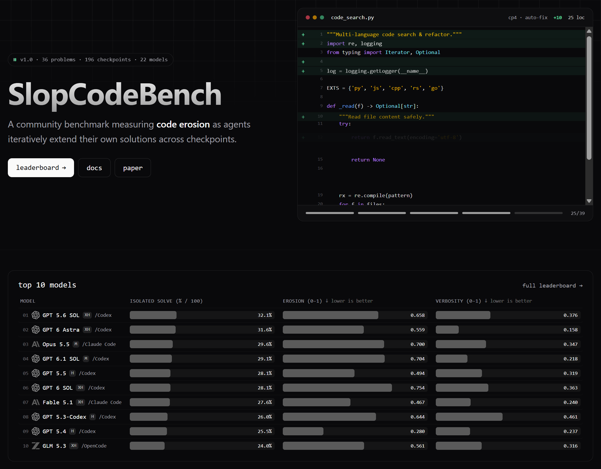

Every major model launch now comes with impressive charts showing coding agents solving 70% or 80% of real-world GitHub issues. On the surface, those numbers make fully autonomous "dark software factories" look right around the corner — and tempt engineering leaders to ask whether human code review is about to become an unnecessary bottleneck.

Look closer at how those benchmarks are built, though, and a critical blind spot appears. Almost all flagship coding evaluations test an agent in isolation on a single ticket inside a repository that was carefully designed, structured, and reviewed by humans over years. Once the agent produces a passing patch, the environment is wiped clean. The agent never has to come back tomorrow and build the next feature on top of the mess it left behind today.

If we want to know how autonomous coding agents perform over the real lifecycle of a software project—and whether we are anywhere near removing human review from critical codebases—our benchmarks need to measure **code quality across consecutive agentic development**.

## What big AI labs benchmark today—and the hidden human crutch

When Anthropic, OpenAI, and Google DeepMind publish coding evaluations for frontier releases, three benchmark families dominate their model cards and announcements:

- **SWE-bench Verified and SWE-bench Pro:** [SWE-bench Verified](https://www.swebench.com/) evaluates 500 human-validated GitHub issues primarily in mature open-source Python repositories such as Django. Because scores above 70%–80% raised concerns about saturation and training-data contamination, labs increasingly pair it with **SWE-bench Pro** (developed by Scale AI), which introduces 1,865 tasks across diverse consumer, B2B, and developer-tool repositories (a 731-task public copyleft split where top models initially scored ~23% at launch, and a 276-task private startup split where top models rose from 14.9%–17.8% at launch to roughly 43%–51.5% by late 2026). Both, however, grade **single-PR bug fixes or isolated patches**. After each issue, the repository resets to a clean human commit.
- **LiveCodeBench:** Dynamically collects competitive programming problems (LeetCode and Codeforces style) published after model training cutoffs. It is effective at testing raw algorithmic reasoning without memorization, but competitive puzzles are tiny, self-contained scripts with zero architectural horizon.
- **Terminal-Bench:** Measures agent autonomy inside sandboxed Linux shells—installing packages, fixing broken builds, running scripts, and handling systems or security tasks. It tests operational tool loops and scaffolds (such as Claude Code or custom CLI harnesses), not long-term maintainability of an evolving application.

Every one of these benchmarks has value, but they share the same structural limitation: **they test AI agents leaning on a human-designed architecture**, or operating on disposable one-off tasks. None of them measure what happens when an AI agent's own output accumulates across five, ten, or twenty consecutive requirements.

## SlopCodeBench: measuring code erosion across consecutive features

One benchmark that directly targets this blind spot—and recently shipped new leaderboard updates—is [SlopCodeBench](https://www.scbench.ai/) (`arXiv:2603.24755`, developed by researchers at UW-Madison and collaborators).

Instead of handing an agent a mature repository and a single issue, SlopCodeBench evaluates long-horizon, iterative development:

- **Sequential checkpoints with progressive revelation:** The benchmark comprises 36 problems spanning 196 sequential checkpoints. Specifications are language-agnostic by construction—describing only CLI or API behavior so tasks could in principle be graded in any language—while the published paper and leaderboard evaluate the Python track. An agent starts from an initial specification and must repeatedly extend **its own prior repository** as new requirements arrive one checkpoint at a time. It never sees future requirements upfront.
- **Black-box contracts, unconstrained internals:** Tasks define observable CLI or API behavior while leaving internal module boundaries, function signatures, and data structures entirely up to the agent. At every checkpoint, the codebase must pass all new feature tests **plus every regression test from prior checkpoints**.
- **Measuring code erosion ("slop") alongside correctness:** Alongside strict/isolated solve rates, SlopCodeBench tracks two trajectory-level quality metrics:
  - **Structural Erosion (0–1):** Measures the share of total complexity mass (`CC(f) × √SLOC(f)`) concentrated in high-complexity functions (`CC > 10`), capturing how control flow piles up into brittle "God functions" as features stack up.
  - **Verbosity (0–1):** Measures redundant, AST-grep-flagged anti-pattern lines and structurally cloned lines, normalized by lines of code (LOC).

The empirical findings are sobering for anyone hoping to run an unreviewed AI software factory:

- **Pervasive degradation:** Across evaluated trajectories, structural erosion increases in **77%** of runs, and verbosity rises in **75.5%** of runs.
- **More than 2x bloat versus human code:** When calibrated against 473 human-maintained open-source Python repositories, agent-evolved codebases are **2.3x more verbose** and **2.0x more structurally eroded** (accumulating verbosity 6.6x faster and erosion 5.0x faster per checkpoint than human git histories).
- **Additive patching and compounding debt:** Rather than refactoring or splitting existing callables when a new checkpoint invalidates an early assumption, agents tend to patch new branches directly into existing functions (mean relative lines changed drop from 97.4% early to 29.5% late) while accumulating duplicated code. Early shortcuts rapidly turn into structural traps.
- **Even frontier updates hit a wall:** On recent [scbench.ai](https://www.scbench.ai/) leaderboard updates—including frontier setups from OpenAI (such as GPT-5.6 / GPT-6 variants like Astra and SOL via Codex harnesses) and Anthropic (Opus 5.5 / Fable via Claude Code)—isolated checkpoint solve rates top out around **24% to 32%**, while end-to-end completion across every checkpoint in a problem remains near zero. Even dialing reasoning effort up to the leaderboard's highest tier (`XHigh`)—where `Medium`-effort runs often match or beat `XHigh` on strict solve rate—does not eliminate long-horizon structural decay, and prompt-level style rules fail to halt the downward slope.

## Other benchmarks testing cumulative agentic development

SlopCodeBench is part of a broader shift in research away from single-shot patching toward longitudinal and multi-step engineering evaluations. Several complementary benchmarks examine adjacent parts of the same problem:

- **Multi-step SWE** (*Can Coding Agents Keep Building on Their Own Code Over Long Horizons?*, `arXiv:2611.07166`): Evaluates 69 engineering tasks across 9 programming languages, structured as chains of 5 to 15 dependent steps where step `k` starts from the exact workspace produced by step `k-1`. While top models pass roughly half of individual steps sequentially (up to 56.8% for Claude Opus 5.5 and 49.1% for Claude Fable 5.1), full-chain completion plunges to **18.5% or below**, and 38 of the 69 tasks remain unsolved by any evaluated model. *(Status: newly released on **November 4, 2026** with an accompanying leaderboard at `multistepswe.com`; static 69-task suite rather than continuously refreshed tasks.)*
- **SWE-EVO** (*Benchmarking Coding Agents in Long-Horizon Software Evolution Scenarios*, `arXiv:2512.18470`): Derives multi-step software evolution tasks from real release notes and version histories of mature open-source Python projects, averaging 21 modified files and 874 validation tests per task. Model setups such as GPT-5.2 drop from **72.8%** on SWE-bench Verified to **22.9%** on SWE-EVO, with the best evaluated model (GPT-5.4 with OpenHands) resolving only **25%**. *(Status: static 48-task dataset; paper published **December 20, 2025**, and the official GitHub repository `FSoft-AI4Code/SWE-EVO` was published on **May 3, 2026** with no continuous updates since.)*
- **FeatureBench** (*Benchmarking Agentic Coding for Complex Feature Development*, `arXiv:2602.10975`): Moves beyond single-PR bug fixes by tracing complete features across dependency graphs and multiple commits or pull requests. Models achieving roughly 74.4% on SWE-bench drop to **11.0%–12.5%** resolved on the 200-task Full split (while newer frontier setups reach **20%–46.7%** resolved on the smaller 30-task Lite split). *(Status: **actively maintained and designed to be continually refreshable** via an automated test-driven pipeline; paper released **February 11, 2026**, leaderboard updated in **May 2026**, and repository/v1.1 dataset updated **October 30, 2026**.)*
- **Commit0** (`arXiv:2412.01769`): Challenges agents to build entire software libraries from scratch ("Commit 0") given API specifications, unit tests, and a starter repository where module layout and public API signatures are preserved but all implementation bodies are stripped to stubs. *(Status: static benchmark; paper released **December 2, 2024**, public leaderboard last updated **November–December 2024**, with only occasional harness fixes in GitHub—most recently **February 24, 2026**—rather than ongoing model evaluations.)*

| Benchmark | Starting Codebase | Task Horizon | Builds on Own Prior Output? | Tracks Code Quality / Erosion? | Update Cadence / Last Updated | Primary Signal Exposed |
| --- | --- | --- | --- | --- | --- | --- |
| **SWE-bench (Verified / Pro)** | Mature human repo | Single PR / issue | No (resets each task) | No | Static (Verified 2024; Pro Sep 2025) | Single-ticket patching with human architecture |
| **LiveCodeBench** | Empty file | Single algorithm | No | No | **Updated continuously** | Contamination-free algorithmic reasoning |
| **Terminal-Bench** | Sandboxed shell env | Single CLI workflow | No | No | Periodically versioned (4.0/4.1 in 2026) | Autonomous shell, build, and DevOps execution |
| **SlopCodeBench** | Greenfield spec | Sequential checkpoints | **Yes** | **Yes** (erosion & verbosity) | Active leaderboard (Oct 26, 2026) | Structural decay and compounding slop over iterations |
| **Multi-step SWE** | Greenfield or repo | 5–15 dependent steps | **Yes** | Indirectly via step failure | Released Nov 4, 2026 (static suite) | Cascading architectural errors across phases |
| **SWE-EVO** | Mature human repo | Release-scale evolution | No (single release patch) | No (uses Fix Rate) | Static (paper Dec 2025; repo May 2026) | Multi-file planning and regression control |
| **FeatureBench** | Mature human repo | Multi-PR feature | No (single feature patch) | No | **Refreshable** / active (Oct 30, 2026) | End-to-end feature integration across dependencies |
| **Commit0** | Repo with stubbed bodies | Full library spec | No (single library build) | No | Static (leaderboard late 2024; repo Feb 2026) | Implementing full library logic from API stubs and specs |

Notice the pattern across every benchmark that forces agents either to design architecture from scratch or to live with their own previous commits: scores collapse compared to single-shot benchmarks, and **SlopCodeBench** goes a step further by explaining *why* they collapse.

## What this means for software factories and code review

For teams building software with AI agents—or experimenting with fully automated software factories—these results carry three practical consequences.

First, **single-ticket pass rates are a misleading proxy for long-term velocity**. In continuous agentic development, today's generated diff becomes tomorrow's codebase and context window. When an agent solves ticket `k` by duplicating helper logic and inflating a 400-line handler function, automated tests will stay green today—right up until ticket `k+4` becomes unsolvable because neither the agent nor a human reviewer can untangle the accumulated state and control flow.

Second, **we are not at the point of dropping human code review in critical, long-lived codebases**. Passing unit and integration tests at checkpoint `k` proves functional correctness for the current specification, not architectural survivability for checkpoint `k+5`. Human review remains the primary defense against additive patching, semantic code duplication, and creeping abstraction rot.

Third, **human code review and agent harnesses need to shift their focus**. Reviewing AI-generated pull requests line by line for syntax errors or off-by-one bugs is low-leverage when tests and linters already catch them. Instead, human reviewers—and automated quality gates inside agent loops—must act as **architectural entropy controllers**:

- Rejecting additive patches that work around bad abstractions instead of refactoring them.
- Enforcing complexity ceilings, modularity rules, and code-health checks (via static analyzers or MCP-integrated quality tools) before an agent is allowed to declare a task done.
- Requiring living architectural boundaries and explicit cleanup phases between feature iterations rather than chaining endless feature prompts onto a single trajectory.

## Summary

Single-shot benchmarks built on heavily reviewed human repositories tell us how well an AI agent can act as a temporary contractor fixing one isolated issue in someone else's clean house. Longitudinal benchmarks like [SlopCodeBench](https://www.scbench.ai/), Multi-step SWE, and SWE-EVO tell us what happens when the agent has to maintain the house it built over months of consecutive changes. Until agents can extend their own codebases without doubling verbosity and concentrating complexity into unmaintainable modules, human architectural oversight and disciplined code review remain non-negotiable.
