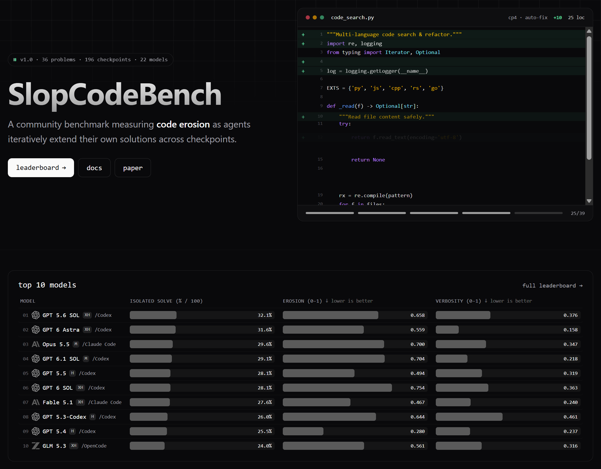

Każdej dużej premierze nowego modelu towarzyszą dziś efektowne wykresy pokazujące agentów programistycznych rozwiązujących 70% lub 80% prawdziwych zgłoszeń na GitHubie. Na pierwszy rzut oka takie wyniki sprawiają wrażenie, że w pełni autonomiczne „ciemne fabryki oprogramowania” są tuż za rogiem — i kuszą liderów technicznych do pytania, czy ludzkie code review nie staje się już zbędnym wąskim gardłem.

Kiedy jednak przyjrzeć się bliżej temu, jak te benchmarki są skonstruowane, widać wyraźną lukę. Niemal wszystkie flagowe ewaluacje testują agenta w izolacji na jednym zadaniu, wewnątrz repozytorium starannie zaprojektowanego, rozwijanego i recenzowanego przez ludzi przez wiele lat. Gdy agent dostarczy działającą poprawkę, środowisko jest czyszczone. Agent nigdy nie musi wrócić następnego dnia i dopisać kolejnej funkcji na bazie kodu, który sam wcześniej wytworzył.

Jeśli chcemy wiedzieć, jak autonomiczni agenci radzą sobie w długim cyklu życia projektu — i czy jesteśmy już w punkcie, w którym można zrezygnować z code review w kluczowych systemach — nasze benchmarki muszą mierzyć **jakość kodu w kolejnych iteracjach rozwoju przez agentów**.

## Co dziś mierzą wielkie laboratoria AI — i ukryta ludzka podpora

Gdy Anthropic, OpenAI oraz Google DeepMind publikują wyniki programistyczne przy premierach swoich modeli, w raportach dominują trzy rodziny benchmarków:

- **SWE-bench Verified i SWE-bench Pro:** [SWE-bench Verified](https://www.swebench.com/) sprawdza 500 zweryfikowanych zgłoszeń z GitHuba, głównie w dojrzałych pythonowych repozytoriach open source, takich jak Django. Ponieważ wyniki powyżej 70%–80% zaczęły ujawniać nasycenie benchmarku i ryzyko kontaminacji danych treningowych, laboratoria coraz częściej sięgają po **SWE-bench Pro** (opracowany przez Scale AI), który obejmuje 1 865 zadań w zróżnicowanych projektach konsumenckich, B2B i narzędziach deweloperskich (publiczny zbiór 731 zadań opartych na licencjach copyleft, na którym w momencie premiery czołowe modele osiągały ok. 23%, oraz prywatny zbiór 276 zadań ze startupów, gdzie najlepsze wyniki wzrosły z 14,9%–17,8% na starcie do ok. 43%–51,5% pod koniec 2026 roku). Oba benchmarki oceniają jednak **pojedyncze poprawki lub izolowane pull requesty**. Po każdym zadaniu repozytorium wraca do czystego commita stworzonego przez człowieka.
- **LiveCodeBench:** Dynamicznie zbiera zadania algorytmiczne (w stylu LeetCode i Codeforces) publikowane po dacie odcięcia danych treningowych modelu. Świetnie sprawdza czyste rozumowanie algorytmiczne bez pamięciowego odtwarzania rozwiązań, ale są to krótkie, samowystarczalne skrypty bez żadnego horyzontu architektonicznego.
- **Terminal-Bench:** Mierzy autonomię agenta wewnątrz odizolowanej powłoki Linux — instalowanie pakietów, naprawianie procesów budowania, uruchamianie skryptów oraz zadania administracyjne i bezpieczeństwa. Ocenia pętlę narzędziową i środowisko uruchomieniowe (np. Claude Code lub własne harnessy CLI), a nie długofalową utrzymywalność rozwijanej aplikacji.

Każdy z tych benchmarków ma swoją wartość, ale wszystkie łączy to samo ograniczenie: **testują agentów AI opierających się na architekturze zaprojektowanej przez człowieka** albo wykonujących jednorazowe operacje. Żaden z nich nie mierzy efektu kumulacji kodu generowanego przez AI w pięciu, dziesięciu czy dwudziestu kolejnych wymaganiach.

## SlopCodeBench: pomiar erozji kodu w kolejnych funkcjach

Jednym z benchmarków, który bezpośrednio adresuje tę lukę — i niedawno doczekał się aktualizacji wyników — jest [SlopCodeBench](https://www.scbench.ai/) (`arXiv:2603.24755`, opracowany przez badaczy z UW-Madison i współpracowników).

Zamiast dawać agentowi gotowe, dojrzałe repozytorium i pojedyncze zgłoszenie, SlopCodeBench testuje długohoryzontowy, iteracyjny rozwój oprogramowania:

- **Sekwencyjne checkpointy ze stopniowym ujawnianiem wymagań:** Benchmark składa się z 36 problemów podzielonych na 196 kolejnych checkpointów. Specyfikacje są z założenia niezależne od języka programowania — opisują wyłącznie zachowanie CLI lub API, dzięki czemu zadania można teoretycznie oceniać w dowolnym języku — natomiast opublikowana praca i tablica wyników weryfikują ścieżkę w języku Python. Agent zaczyna od wstępnej specyfikacji, a następnie musi wielokrotnie rozbudowywać **własne wcześniejsze rozwiązanie** wraz z napływaniem kolejnych wymagań. Nigdy nie zna przyszłych etapów z góry.
- **Kontrakty black-box bez narzuconej struktury wewnętrznej:** Testy weryfikują wyłącznie obserwowalne zachowanie na granicy CLI lub API, zostawiając podział na moduły, sygnatury funkcji i struktury danych całkowicie w rękach agenta. Na każdym checkpoincie kod musi przejść zarówno nowe testy funkcji, jak i **wszystkie testy regresyjne z poprzednich etapów**.
- **Pomiar erozji kodu („slopu”) obok poprawności:** Poza ścisłym odsetkiem zaliczonych checkpointów SlopCodeBench śledzi dwie metryki jakościowe dla całej trajektorii zmian:
  - **Erozja strukturalna (0–1):** Mierzy udział całkowitej masy złożoności (`CC(f) × √SLOC(f)`) skupionej w funkcjach o wysokiej złożoności cyklomatycznej (`CC > 10`), pokazując, jak logika odkłada się w kruchych „funkcjach-bogach” wraz z przyrostem funkcji.
  - **Gadatliwość / rozwlekłość (Verbosity, 0–1):** Mierzy przyrost linii oflagowanych regułami AST-grep jako antywzorce oraz zduplikowanych klonów kodu, normalizowany względem liczby linii kodu (LOC).

Wyniki empiryczne są zimnym prysznicem dla wizji w pełni bezobsługowych fabryk oprogramowania:

- **Powszechna degradacja:** W badanych trajektoriach erozja strukturalna rośnie w **77%** przebiegów, a rozwlekłość kodu w **75,5%** przypadków.
- **Ponad dwukrotne puchnięcie kodu względem ludzi:** W porównaniu z 473 otwartymi repozytoriami Pythona utrzymywanymi przez programistów kod rozwijany przez agentów jest **2,3-krotnie bardziej rozwlekły** i **2,0-krotnie bardziej zdegradowany strukturalnie** (przyrost rozwlekłości na checkpoint jest 6,6x szybszy, a erozji 5,0x szybszy niż w ludzkich repozytoriach).
- **Doklejanie poprawek zamiast refaktoryzacji:** Gdy nowy checkpoint podważa wcześniejsze założenie, agenci zamiast refaktoryzować lub dzielić istniejące funkcje doklejają nowe gałęzie bezpośrednio w ich wnętrzu (odsetek modyfikowanych linii spada średnio z 97,4% na początku do 29,5% pod koniec) i akumulują duplikację. Wczesne skróty szybko zamieniają się w pułapki architektoniczne.
- **Nawet najnowsze modele napotykają ścianę:** Na zaktualizowanej tablicy wyników [scbench.ai](https://www.scbench.ai/) — obejmującej czołowe konfiguracje OpenAI (m.in. warianty GPT-5.6 / GPT-6, takie jak Astra i SOL w harnessach Codex) oraz Anthropic (Opus 5.5 / Fable przez Claude Code) — odsetek zaliczonych pojedynczych checkpointów zatrzymuje się w okolicach **24%–32%**, natomiast pełne przejście wszystkich checkpointów w zadaniu od początku do końca pozostaje bliskie zera. Co więcej, podbicie budżetu rozumowania do najwyższego poziomu na tablicy (`XHigh`) — gdzie konfiguracje `Medium` często dorównują lub przewyższają `XHigh` w ścisłym zaliczaniu checkpointów — nie zatrzymuje długoterminowego rozpadu struktury, a same instrukcje jakościowe w prompcie spowalniają problem tylko na starcie.

## Inne benchmarki badające kumulatywny rozwój przez agentów

SlopCodeBench wpisuje się w szerszy nurt badań odchodzących od jednorazowych łatek na rzecz oceny długohoryzontowej ewolucji kodu. Kilka innych benchmarków bada pokrewne aspekty tego samego zjawiska:

- **Multi-step SWE** (*Can Coding Agents Keep Building on Their Own Code Over Long Horizons?*, `arXiv:2611.07166`): Zawiera 69 zadań inżynierskich w 9 językach programowania, podzielonych na łańcuchy od 5 do 15 zależnych od siebie kroków, gdzie krok `k` startuje bezpośrednio ze stanu repozytorium zostawionego przez krok `k-1`. Choć czołowe modele zaliczają sekwencyjnie około połowy pojedynczych kroków (do 56,8% dla Claude Opus 5.5 i 49,1% dla Claude Fable 5.1), skuteczność ukończenia całego łańcucha spada do **18,5% lub poniżej**, a 38 z 69 zadań nie potrafił ukończyć w całości żaden badany model. *(Status: świeża publikacja z **4 listopada 2026** z towarzyszącym rankingiem na `multistepswe.com`; statyczny zestaw 69 zadań zamiast stale odświeżanego zbioru.)*
- **SWE-EVO** (*Benchmarking Coding Agents in Long-Horizon Software Evolution Scenarios*, `arXiv:2512.18470`): Wykorzystuje historyczne opisy wydań (release notes) dojrzałych projektów Pythona do tworzenia wieloetapowych zadań ewolucji kodu, obejmujących średnio 21 modyfikowanych plików i 874 testy na zadanie. Modele takie jak GPT-5.2 spadają z **72,8%** na SWE-bench Verified do **22,9%** na SWE-EVO, a najlepszy oceniony model (GPT-5.4 z OpenHands) rozwiązuje jedynie **25%** zadań. *(Status: statyczny zbiór 48 zadań; artykuł ukazał się **20 grudnia 2025**, a oficjalne repozytorium `FSoft-AI4Code/SWE-EVO` opublikowano **3 maja 2026** bez dalszych ciągłych aktualizacji.)*
- **FeatureBench** (*Benchmarking Agentic Coding for Complex Feature Development*, `arXiv:2602.10975`): Odchodzi od pojedynczych zgłoszeń błędów, wyodrębniając złożone funkcje obejmujące wiele commitów i pull requestów powiązanych w grafie zależności. Modele osiągające około 74,4% na SWE-bench spadają do **11,0%–12,5%** na pełnym zbiorze 200 zadań (Full split), podczas gdy nowsze konfiguracje osiągają **20%–46,7%** na mniejszym, 30-zadaniowym podzbiorze Lite split. *(Status: **aktywnie rozwijany i zaprojektowany do ciągłego odświeżania** dzięki automatycznemu pipeline'owi opartemu na testach; publikacja z **11 lutego 2026**, aktualizacja rankingu w **maju 2026**, a repozytorium i wersja v1.1 zaktualizowane **30 października 2026**.)*
- **Commit0** (`arXiv:2412.01769`): Stawia przed agentami zadanie napisania całych bibliotek („Commit 0”) na podstawie specyfikacji API, testów jednostkowych i repozytorium startowego, w którym układ modułów oraz publiczne sygnatury funkcji i klas zostały zachowane, lecz wszystkie ciała implementacji usunięto do postaci pustych zaślepek (stubów). *(Status: statyczny benchmark; artykuł z **2 grudnia 2024**, publiczny ranking ostatnio aktualizowany w **listopadzie–grudniu 2024**, a repozytorium otrzymuje jedynie sporadyczne poprawki środowiska testowego — ostatnio **24 lutego 2026** — bez ciągłych ewaluacji nowych modeli.)*

| Benchmark | Baza startowa | Horyzont zadania | Buduje na własnym kodzie? | Mierzy jakość / erozję kodu? | Częstotliwość / ostatnia aktualizacja | Główny obserwowany sygnał |
| --- | --- | --- | --- | --- | --- | --- |
| **SWE-bench (Verified / Pro)** | Dojrzałe repozytorium ludzi | Pojedynczy PR / błąd | Nie (reset po zadaniu) | Nie | Statyczny (Verified 2024; Pro IX 2025) | Łatanie pojedynczych zgłoszeń na ludzkiej architekturze |
| **LiveCodeBench** | Pusty plik | Pojedynczy algorytm | Nie | Nie | **Aktualizowany stale** | Rozumowanie algorytmiczne bez kontaminacji |
| **Terminal-Bench** | Środowisko powłoki Linux | Pojedynczy proces CLI | Nie | Nie | Okresowe wersje (4.0/4.1 w 2026) | Autonomia w terminalu, budowaniu i zadaniach DevOps |
| **SlopCodeBench** | Specyfikacja od zera | Kolejne checkpointy | **Tak** | **Tak** (erozja i rozwlekłość) | Aktywny ranking (26 X 2026) | Degradacja struktury i narastający slop w iteracjach |
| **Multi-step SWE** | Od zera lub repozytorium | 5–15 zależnych kroków | **Tak** | Pośrednio przez awarie kroków | Wydany 4 XI 2026 (statyczny zbiór) | Kaskadowe błędy architektoniczne między etapami |
| **SWE-EVO** | Dojrzałe repozytorium ludzi | Ewolucja na skalę wydania | Nie (pojedyncza łatka wydania) | Nie (metryka Fix Rate) | Statyczny (artykuł XII 2025; repo V 2026) | Planowanie na wielu plikach i kontrola regresji |
| **FeatureBench** | Dojrzałe repozytorium ludzi | Funkcja przez wiele PR | Nie (pojedyncza łatka funkcji) | Nie | **Odświeżalny** / aktywny (30 X 2026) | Integracja nowych funkcji w grafie zależności |
| **Commit0** | Repozytorium ze stubami | Cała biblioteka wg API | Nie (jedna implementacja biblioteki) | Nie | Statyczny (ranking koniec 2024; repo II 2026) | Implementacja logiki biblioteki na bazie stubów API i specyfikacji |

Widać wyraźny wzorzec: w każdym benchmarku, który zmusza agentów albo do zaprojektowania architektury od zera, albo do dalszej pracy na własnych wcześniejszych commitach, skuteczność gwałtownie spada względem testów jednorazowych. **SlopCodeBench** idzie krok dalej i pokazuje liczbowo, *dlaczego* ten spadek następuje.

## Co to oznacza dla fabryk oprogramowania i code review

Dla zespołów budujących oprogramowanie z pomocą agentów — lub eksperymentujących z autonomicznymi fabrykami oprogramowania — z badań tych płyną trzy konkretne wnioski.

Po pierwsze, **skuteczność na pojedynczych zgłoszeniach jest mylącym wskaźnikiem długoterminowej produktywności**. W ciągłym rozwoju agentowym dzisiejsza zmiana staje się jutrzejszą bazą kodu i oknem kontekstowym. Jeśli agent rozwiąże zadanie `k`, duplikując logikę i rozbudowując 400-linijkową funkcję obsługującą, wszystkie testy zaświecą się dziś na zielono — ale już przy zadaniu `k+4` projekt może stać się praktycznie nierozwijalny, bo ani agent, ani człowiek nie zdoła bezpiecznie opanować nagromadzonego stanu i rozgałęzień.

Po drugie, **nie jesteśmy jeszcze w punkcie, w którym można zrezygnować z ludzkiego code review w kluczowych, dużych bazach kodu**. Przejście testów na checkpoincie `k` dowodzi wyłącznie poprawności funkcjonalnej dla dzisiejszego wymagania, a nie tego, czy architektura przetrwa checkpoint `k+5`. Przegląd kodu przez człowieka pozostaje główną barierą przed doklejaniem kolejnych łatek zamiast refaktoryzacji, semantyczną duplikacją i cichym rozpadem abstrakcji.

Po trzecie, **samo code review oraz narzędzia wokół agentów muszą zmienić swój ciężar**. Ręczne wyłapywanie literówek czy prostych błędów brzegowych traci sens, gdy robią to testy i lintery. Rolą ludzkich recenzentów — oraz zautomatyzowanych bramek jakości w pętlach agentowych — staje się **kontrola entropii architektonicznej**:

- Odrzucanie zmian „doklejanych”, które obchodzą złą abstrakcję zamiast ją zrefaktoryzować.
- Egzekwowanie limitów złożoności, granic modułów i metryk kondycji kodu (np. przez analizatory statyczne lub narzędzia jakości podpięte przez MCP), zanim agent uzna zadanie za zakończone.
- Wprowadzanie jawnych faz porządkowania i utrzymywanie żywych granic architektonicznych pomiędzy kolejnymi funkcjami, zamiast bezrefleksyjnego dokładania kolejnych promptów na jedną gałąź kodu.

## Podsumowanie

Jednorazowe benchmarki oparte na starannie utrzymanych przez ludzi repozytoriach pokazują, jak dobrze agent AI radzi sobie jako tymczasowy podwykonawca naprawiający jedną usterkę w cudzym, zadbanym domu. Długohoryzontowe benchmarki takie jak [SlopCodeBench](https://www.scbench.ai/), Multi-step SWE czy SWE-EVO pokazują, co dzieje się wtedy, gdy agent musi przez miesiące utrzymywać i rozbudowywać dom, który sam zbudował. Dopóki agenci nie nauczą się rozwijać własnego kodu bez podwajania jego rozwlekłości i kumulowania złożoności w nieutrzymywalnych modułach, nadzór architektoniczny i rzetelne code review pozostają niezbędne.
